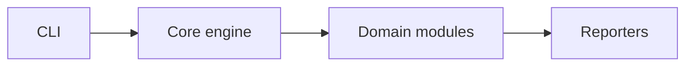

# DB_Security_Audit — architecture

## Purpose

Runs a scripted Firebase Auth + Realtime Database workflow against a configured project.
Inputs are env/config for the target; outputs are console evidence suitable for reports.
Non-goals: exploiting unrelated tenants or storing captured credentials.

## High-level flow

## Module map

| Path             | Responsibility                              |
| ---------------- | ------------------------------------------- |
| `index.ts`       | Live audit orchestration                    |
| `audit-utils.ts` | Testable helpers (IDs, error normalization) |
| `src/logging/`   | Structured logger                           |

## Extension

1. Add a module under the appropriate `src/` folder.
2. Register it in the orchestrator (if applicable).
3. Add unit tests with mocks — no live network in unit tests.
4. Run `npm test` and `npm run format:check`.

## Testing strategy

- **Unit**: mocked I/O, pure parsers, reporters.
- **Integration** (if present): live targets documented in README; optional in CI or
  scheduled.

## Ethics & scope

Authorized engagements only. See [SECURITY.md](./SECURITY.md).
